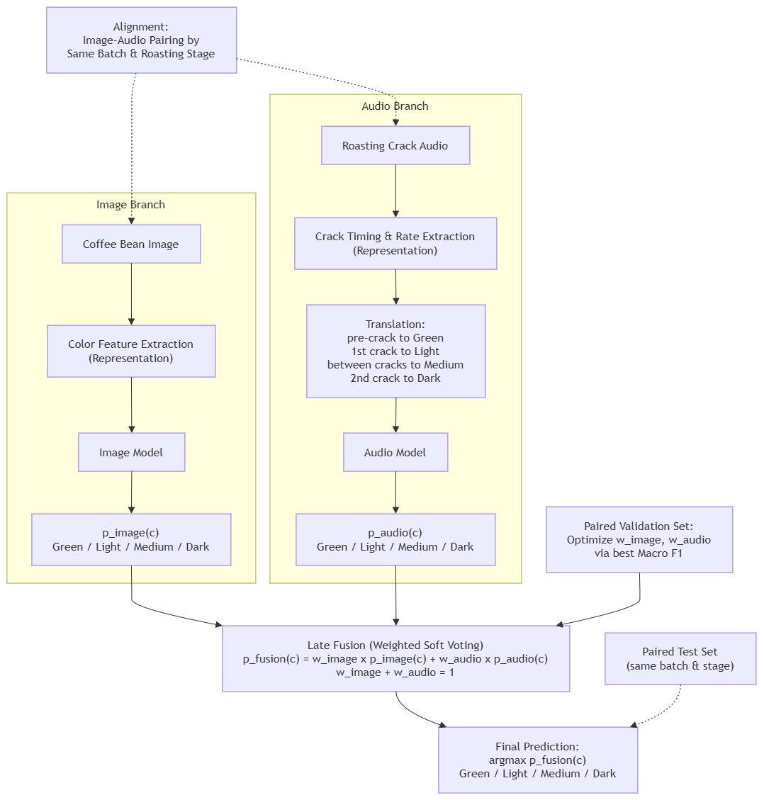

# Coffee Roast Classification

Implementasi **Multimodal Classification of Coffee Roast Level Using Bean Color Images and Roasting Crack Sound**, untuk tugas mata kuliah Rekayasa Fitur dan Pengenalan Pola, Magister Ilmu Komputer, Universitas Gadjah Mada.

Anggota Kelompok:
1. Alif Ilman Nafian (25/572957/PPA/07203)
2. Kevin Pratama (25/574311/PPA/07241)
3. Maulana Yusuf Habibi (25/575185/PPA/07275)
4. Alfi Maulana Akbar (25/574622/PPA/07253)

## Google Colab
Pindahkan/import [notebooks/Coffee_Roast_Colab.ipynb](https://colab.research.google.com/github/fimln/rfpp-project/blob/main/notebooks/Coffee_Roast_Colab.ipynb) ke Google Colab, lalu **Runtime > Run all**. Notebook mengambil kode dan `requirements.txt` langsung dari repository tanpa menyimpan salinan source di dalam sel.

## Metode

| Komponen | Implementasi |
| --- | --- |
| Fitur gambar | RGB + HSV: histogram 16 bin per kanal, mean, dan standar deviasi (108 fitur), dari seluruh frame tanpa segmentasi bean |
| Fitur audio | Durasi, peak, RMS, ZCR, centroid, bandwidth, rolloff, lima band energi, kepadatan dan interval puncak lokal (15 fitur) |
| Klasifikasi | SVM RBF dan Random Forest 200 pohon, bobot kelas seimbang, tanpa pencarian hyperparameter |
| Seleksi | Dilatih hanya pada train, pilih akurasi validasi tertinggi (seri: SVM). `StandardScaler` hanya fit pada train |
| Evaluasi | Held-out test: accuracy, precision/recall/F1 per kelas, macro/weighted F1, confusion matrix |

**Split data** (duplikat dibuang berdasarkan hash SHA-256, seed 42)

| Data | File asli | Unik | Train / Val / Test |
| --- | --- | --- | --- |
| Gambar | 1.600 | 1.194 | 614 / 180 / 400 |
| Audio | 4.304 | 3.557 | 2.334 / 592 / 631 |

- Gambar: prioritas test, validasi stratified 15% dari total unik. Test penerbit dipertahankan, sehingga train dan validasi mengisi sisanya.
- Audio: split dari paper yang ada dipertahankan, prioritas deduplikasi test > val > train. Delapan trial beririsan antara train dan test.
- Audio berupa cuplikan event pendek, sehingga kepadatan dan interval puncak hanya menggambarkan puncak lokal dalam satu cuplikan. Jumlah file audio aktual 4.304, sedangkan dokumentasi upstream menyebut 4.301.

## Fusion dan batasan ilmiah

`coffee.fusion.fuse` menggabungkan probabilitas gambar dan audio dengan bobot proporsional akurasi validasi tiap modalitas. Dataset gambar (4 kelas) dan audio (3 kelas, tanpa Medium) tidak berpasangan, sehingga bobot ini berperan sebagai aturan heuristik.

- First Crack dipetakan ke Light, Second Crack ke Dark.
- Background: jika tahap diketahui, masukkan `Green` (sebelum first crack) atau `Medium` (di antara dua crack). Tanpa konteks, mengikuti distribusi gambar.
- Evaluasi fusion memerlukan gambar, audio, dan label dari batch roasting yang sama.

### Simulasi fusion Light–Dark dengan pairing sintetis

Notebook menambahkan eksperimen otomatis dua kelas: gambar Light dipasangkan dengan audio First Crack, gambar Dark dengan Second Crack. Green, Medium, dan Background dikeluarkan hanya dari simulasi ini. Eksperimen gambar empat kelas dan audio tiga kelas tetap ditampilkan terpisah.

Pasangan dibuat berdasarkan label di dalam split validasi dan test masing-masing, memakai seed 42–46. Setiap seed memakai jumlah pasangan seimbang antarkelas, sebanyak kelas/modalitas dengan sampel paling sedikit pada split tersebut, tanpa pengulangan file dalam satu split/seed. File dapat muncul kembali pada seed lain. Tidak ada pasangan lintas split, dan tidak ada pasangan train yang diperlukan karena model unimodal sudah dilatih pada train; fusion hanya menggabungkan probabilitas.

Model gambar/audio yang sudah dipilih dari validasi digunakan kembali. Probabilitas dibatasi dan dinormalisasi ulang menjadi Light/Dark (First/Second Crack untuk audio), sehingga skor ini bersifat kondisional pada dua kelas tersebut. Bobot gambar dicari pada grid 0–1 dengan langkah 0,05, menggunakan macro F1 pasangan validasi saja; bobot audio adalah 1 dikurangi bobot gambar. Jika seri, dipilih bobot paling dekat 0,5. Semua seed dilaporkan, tanpa memilih seed berdasarkan test. Gambar saja, audio saja, dan fusion dibandingkan pada pasangan test identik; ditampilkan rata-rata dan standar deviasi antar-seed serta confusion matrix seed pertama.

**Batasan:** ini simulasi pada pasangan sintetis yang kelasnya sengaja dibuat konsisten, bukan rekaman gambar–audio dari batch roasting yang sama. Label digunakan untuk membangun pasangan, sehingga kesesuaian kedua modalitas sudah diasumsikan. Skor tidak membuktikan akurasi fusion pada roasting nyata atau manfaat sinkronisasi waktu. First/Second Crack dipakai sebagai proxy Light/Dark, bukan pengukuran roast independen. Variasi antar-seed bukan confidence interval karena file test dipakai kembali. Irisan trial audio pada split penerbit juga tetap membatasi generalisasi.

Diagram metode di atas menggambarkan rancangan ideal dengan data berpasangan asli; simulasi ini tidak memenuhi asumsi same batch/stage pada diagram. Kesimpulan notebook secara eksplisit membedakan simulasi dan evaluasi roasting nyata.

## Berkas hasil

- `outputs/metrics.json`: metrik dan audit.
- `outputs/*_manifest.json`: split (path dan label per sampel).
- `outputs/image.joblib`, `outputs/audio.joblib`: model, kelas, dan akurasi validasi.
- `outputs/*_test_predictions.npz`: label dan probabilitas test.
- `reports/verification.md`: pengujian yang benar-benar dijalankan.

Urutan kelas confusion matrix: Green, Light, Medium, Dark (gambar); Background, First Crack, Second Crack (audio).

Tes mencakup fitur, audio hening, fusion, validasi input, ZIP traversal, dan integrasi data nyata (dilewati jika folder data tidak ada).

## Sumber dan atribusi

- [Coffee Bean Dataset Resized, gpiosenka](https://www.kaggle.com/datasets/gpiosenka/coffee-bean-dataset-resized-224-x-224), CC BY-SA 4.0, cite Ontoum et al. (2022), [Coffee Roast Intelligence](https://doi.org/10.48550/arXiv.2206.01841).
- [Coffee Roasting Acoustic Dataset, Shi, Li, He](https://github.com/Theseus-427/coffee-roasting-acoustic-dataset), CC BY 4.0. Dataset diunduh tanpa perubahan konten.
- Nair et al. (2025), [CBD: Coffee Beans Dataset](https://doi.org/10.1016/j.dib.2025.111434), dasar pendekatan klasifikasi fitur pada proposal (hanya sebagai referensi).
- Wilson (2014), [Coffee roasting acoustics](https://doi.org/10.1121/1.4874355), landasan karakteristik first/second crack.
